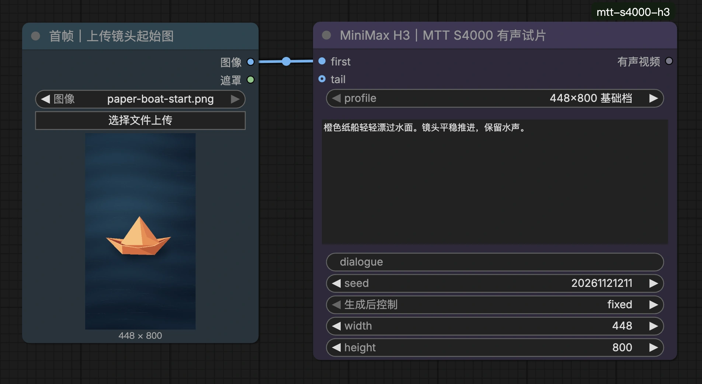
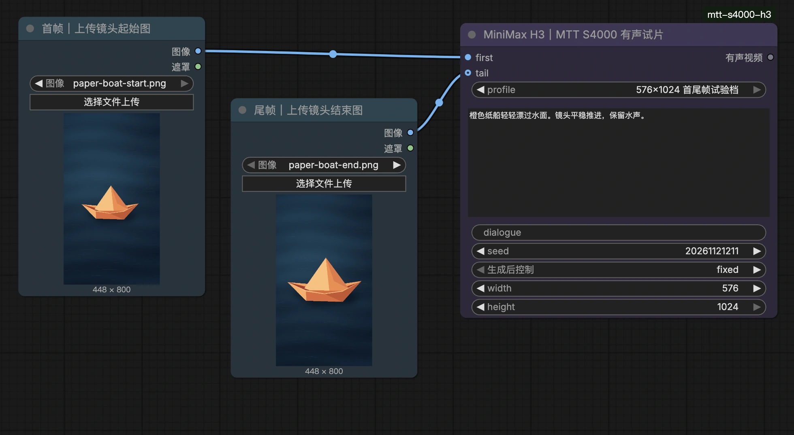

<h1 align="center">MiniMax H3 · S4000 有声短片工作台</h1>

<p align="center">在单张摩尔线程 MTT S4000 上，用 ComfyUI 把首帧或首尾帧做成约 5 秒的有声短片。</p>

<p align="center">
  <a href="https://github.com/amethyst-cosmos/comfyui-mtt-h3/releases/tag/v0.1.0-preview"></a>
  
  
</p>

<p align="center">
  <a href="#安装与运行">安装与运行</a> ·
  <a href="#实卡实验与成本">实卡实验与成本</a> ·
  <a href="#冷启动发布门槛">冷启动发布门槛</a>
</p>

同一 S4000 镜头的历史原生对照中，**四步配置把进程耗时从 6 分 04 秒降到 4 分 03 秒，缩短约 33%**。两套中文模板把关键帧、动作、台词和宽高集中到一个节点，生成后可在画布内审听模型原声。

> [!NOTE]
> 当前为源码预览版，需已有 S4000 MUSA 推理环境及匹配权重。节点和模板已完成桌面验证，整套环境仍待干净 S4000 冷启动验收。

## 工作流截图

| 首帧有声试片 · 448×800 | 首尾帧高清试验 · 576×1024 |
| :--- | :--- |
| [](docs/screenshots/first-frame.webp) | [](docs/screenshots/first-last-frame.webp) |
| 一张起始图，适合先试台词、动作和运镜。 | 两张关键帧，适合明确镜头的起点和终点。 |

截图来自本地 ComfyUI 0.45.3 的实际模板导入，纸船是演示输入。点击截图查看原图。

## 安装与运行

**准备环境。** 需要单张可见的 MTT S4000（48 GB）、可运行的 ComfyUI、Python 3.11 或更新版本、匹配的 MUSA 运行库、推理程序和 FFmpeg（含 FFprobe）。画布以 CPU 模式启动，由独立 MUSA 进程推理。模型目录需要约 43.86 GB 加四步 LoRA 的空间。程序与模型路径见下方运行时清单。

**安装节点并启动。** 在已有上述环境的机器上执行。按需将 `COMFYUI_DIR` 和 `COMFYUI_PYTHON` 指向现有 ComfyUI 及其 Python 环境。

```bash
git clone https://github.com/amethyst-cosmos/comfyui-mtt-h3.git mtt-s4000-h3
cd mtt-s4000-h3

export COMFYUI_DIR=/root/ComfyUI
"${COMFYUI_PYTHON:-python3}" runtime.py && bash start.sh
```

**打开模板。** 默认访问 `http://127.0.0.1:6006`。从 ComfyUI 的自定义节点模板打开，或把 [首帧有声试片](example_workflows/01%20%C2%B7%20%E9%A6%96%E5%B8%A7%E6%9C%89%E5%A3%B0%E8%AF%95%E7%89%87.json) / [首尾帧高清试验](example_workflows/02%20%C2%B7%20%E9%A6%96%E5%B0%BE%E5%B8%A7%E9%AB%98%E6%B8%85%E8%AF%95%E9%AA%8C.json) 的 JSON 拖入画布。选图、填写动作和可选台词，点击「运行」。两个档位均为 124 帧、24 fps，成片约 5.17 秒。

<details>
<summary><strong>展开运行时文件清单与预检命令</strong></summary>

```text
/root/mtt-h3-runtime/
  sd-cli
  native_flash_bridge.so
  sd-cli-chunk4096        # 首尾帧试验档
  trace_bridge.so        # 首尾帧试验档
  models/
    diffusion_models/minimax_h3_fl2va_pruned-Q8_0.gguf
    text_encoders/qwen3vl_32b_minimax_h3-Q4_K_M.gguf
    vae/minimax_h3_sol_vae_fp16.safetensors
    vae/minimax_h3_audio_vae_fp32.safetensors
    loras/minimax_h3_fl2v_turbo_4step_v1.0_768p_comfyui_bf16.safetensors
```

使用 `MTT_H3_RUNTIME` 指定程序目录，`MTT_H3_MODELS` 指定已挂载的权重目录。基础档使用 `sd-cli` 和原生 muDNN Flash 桥接库。高清试验档还需要前馈和 QKV 投影按最多 4,096 token 分块的程序及跟踪库。

| 命令 | 用途 |
| :--- | :--- |
| `python3 runtime.py` | 检查单张可见 S4000、基础档运行文件及模型指纹 |
| `python3 runtime.py --files-only` | 无卡时检查基础档文件大小、首尾指纹及 LoRA SHA-256 |
| `python3 runtime.py --detail` | 检查首尾帧试验档，也可加 `--files-only` |
| `bash start.sh` | 挂载本节点并启动 ComfyUI |

使用 `COMFYUI_OUTPUT` 修改输出位置，使用 `COMFYUI_PORT` 修改端口。默认只监听本机，采用实例私有服务映射时可设置 `COMFYUI_LISTEN=0.0.0.0`。

</details>

## 实卡实验与成本

### 同一镜头的八步和四步

2026 年 11 月的原生 S4000 对照固定首帧、提示词、种子和输出规格。四步组使用四步 Turbo LoRA。

| 单张 MTT S4000 · 448×800 · 124 帧 | 八步 | 四步 Turbo |
| :--- | ---: | ---: |
| 推理进程耗时 | 364.3 秒 | **243.5 秒** |
| 采样阶段 | 265.7 秒 | **141.4 秒** |
| 完整解码与音轨 | 通过 | 通过 |

这条样片里，两版人物外观和衣料纹理接近，四步版的双手贴头动作约晚 0.75 秒。两组均在完整写出后发生清理阶段异常退出，文件核验通过。

### 两套模板的原生基线

| 档位 | S4000 历史原生结果 | ComfyUI 封装 |
| :--- | :--- | :--- |
| **448×800** · 首帧 | 两条有声样片，约 **4 分钟落盘**（240.6–242.9 秒） | 桌面链路已验证，待实卡冷启动 |
| **576×1024** · 首尾帧 | 一条分块诊断样片，约 **8 分钟落盘**（481.0 秒），黑屏检测为 0 秒 | 桌面模板已验证，待实卡冷启动 |

### 单条算力成本

按历史记录的单卡小时价折算，每条均为 124 帧、24 fps。保留 NVIDIA 参考记录，方便同时比较**小时价、等待时间和输出规格**。

| 方案 | 输出规格 | 历史费率 | 记录耗时 | 折算每条 |
| :--- | :--- | ---: | ---: | ---: |
| **S4000 · H3 Q8 四步** | 448×800 · 首帧有声 | ¥1.86/小时 | 243.5 秒 | **¥0.13** |
| S4000 · H3 Q8 八步 | 448×800 · 同镜头有声 | ¥1.86/小时 | 364.3 秒 | ¥0.19 |
| S4000 · H3 Q8 四步分块 | 576×1024 · 首尾帧有声 | ¥1.86/小时 | 482.0 秒 | ¥0.25 |
| RTX PRO 6000 · H3 Q8 四步 | 576×1024 · 首帧有声 | ¥8.36/小时 | 256.5 秒 | ¥0.60 |
| RTX PRO 6000 · HyperFlow Flash INT8 | 864×480 · 首尾帧无声 | ¥6.98/小时 | 56.7 秒 | ¥0.11 |

折算公式为「记录耗时（秒）÷ 3,600 × 小时价」。在同镜头 S4000 对照中，四步约省 **¥0.06/条**。跨卡记录的工作流、分辨率或音频配置有差异，HyperFlow 一行采用 ComfyUI 任务耗时，其余为原生进程耗时。实例实际按开关机时间计费，还要考虑准备、空转、重试和存储。 [AutoDL 计费说明](https://www.autodl.com/docs/price/)

## 自选尺寸与输出

- **宽高独立设置。** 每边为 32 的倍数，最长边 1,024 像素。`0` 沿用档位默认值。基础档面积上限 358,400 像素，可试 800×448 和 576×576。首尾帧档上限 589,824 像素，可试 1024×576 和 768×768。自选尺寸已验证桌面参数链路，待实卡验收。
- **构图与原声。** 自选尺寸按目标画幅居中裁切关键帧。节点检查解码、分辨率、帧数、音轨和近乎全黑的输出。可在画布内播放带原声的 MP4，台词清晰度与口型以审片为准。
- **每次运行有记录。** 每个镜头在输出目录下独立保存原片、预览、引擎日志和运行回执。`VIDEO` 端口可接后续节点。

## 冷启动发布门槛

- 在干净的单张 S4000 上，用相同素材、种子和参数走原生命令与 ComfyUI 两条入口。依次验 448×800 首帧、576×1024 首尾帧，再验 800×448 和 576×576。
- 记录启动和模型加载时间、出片耗时、峰值显存与主机内存。核对尺寸、124 帧、音轨、黑屏和结束后的进程状态。遇到明显回退时复查日志和输出。
- S3000 与其他 GPU 另行验证。模型及衍生权重的使用和分发遵循上游许可。 [MiniMax H3 社区许可证](https://huggingface.co/MiniMaxAI/MiniMax-H3/blob/main/LICENSE)
